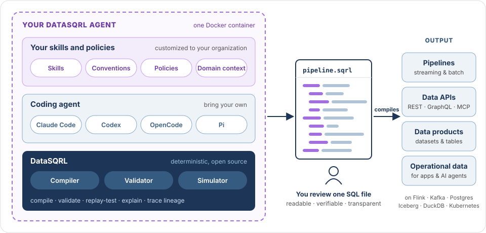
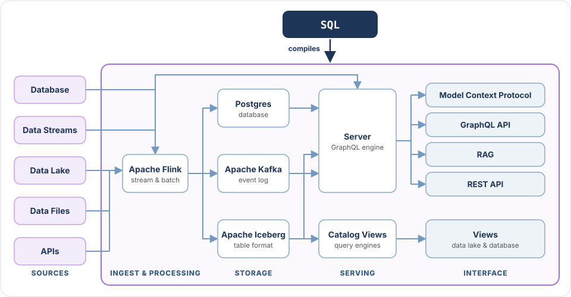

# DataSQRL: Agentic Data Engineering for Operational Data

[](https://dl.circleci.com/status-badge/redirect/gh/DataSQRL/sqrl/tree/main)
[](http://docs.datasqrl.com)
[](https://codecov.io/gh/datasqrl/sqrl)
[](LICENSE)
[](https://hub.docker.com/r/datasqrl/cmd/tags)
[](https://repo1.maven.org/maven2/com/datasqrl/sqrl-root/)

**DataSQRL is an open-source harness for agentic data engineering on operational data: agents build real-time pipelines, data APIs, and data products; a compiler verifies them.**

It extends your coding agent with a SQL compiler, validator, and event-time simulator, so the agent can build real-time pipelines, data APIs (REST, GraphQL, MCP), and data products, and verify them before anything is deployed. Add your own skills and policies to make it your organization's DataSQRL agent.




## When to use DataSQRL

- You need a data API (GraphQL, REST, or MCP) over operational data.
- You build an operational data product with data quality and observability.
- Kafka is in the pipeline, as source, sink, or both.
- Results are needed in seconds or minutes, not after the next batch run.
- An application, a customer, or an AI agent consumes the output, not only a dashboard.
- You are capturing changes from operational systems into data streams or data lakes.

It is not the fit when the work is dbt models on a schedule inside Snowflake, BigQuery, or Databricks.

Working in dbt and a warehouse? [See how DataSQRL differs](https://docs.datasqrl.com/docs/intro/comparison).

## Why DataSQRL

Operational pipelines span several systems and serve live consumers, so mistakes cannot be fixed by rerunning a model. That is why DataSQRL is built on three things.

### 1. Human Control: SQL You Understand

Agents build faster than humans can verify. DataSQRL is designed for human control and understanding so your data pipelines and applications don't become opaque liabilities.

Everything the agent builds, from ingest to transform to store to serve, is expressed as **declarative SQL scripts**. It's easy to follow the logic and concise enough to review in one sitting.

- **Review meaning, not plumbing.** Aggregations, units, filters, and joins sit on one screen. Reviewers can check that the pipeline does what was asked instead of skimming thousands of generated lines.
- **Run it yourself.** One command runs the whole pipeline locally, API included, so you can inspect real results and experiment quickly.
- **Build abstraction layers.** Extend with custom UDFs, table functions, and operators that capture your business semantics.

Agents speed up the work. You still own the logic.

### 2. Compiler for Correctness Across Systems

A language model is a probabilistic tool that's prone to errors and hallucinations. DataSQRL provides a compiler that spans the entire data pipeline, keeping types, names, keys, and schemas consistent across Flink, Kafka, Postgres, Iceberg, and an API layer.

- **Seams are generated.** Types, schemas, connector configs, API contracts, and identifier mappings are all derived from one logical model, so the systems cannot disagree.
- **Deep relational validation.** The validator walks the relational plan and catches bugs that are not visible in the query text: wrong or missing primary keys, changelogs treated as event streams, time-dependent joins, unbounded state, etc. Each error comes with a suggested fix the agent can act on.
- **Event-time replay testing.** The simulator runs the real deployment artifacts and replays events at their original timestamps. Late data, out-of-order events, races between streams, idle sources, updates, and deletes become deterministic test cases instead of production incidents.

### 3. Safety Guardrails You Can Inspect and Extend

Before anything is deployed, the compiler analyzes the whole data flow, and it writes out readable artifacts for physical and deployment plans.

- **Deep artifacts for governance.** Every compilation produces the full computation DAG with table types, inferred keys, timestamps, schemas, and engine assignments, along with every deployment asset. Use these artifacts for data lineage, impact analysis, audit, and automated policy checks.
- **Scalable and fault-tolerant by design.** Deployment artifacts are compiled for robust operations with automatic index selection, partitioning, and fail-over. 
- **Security by construction.** API endpoints use parameterized queries, and authorization is bound to JWT claims in the SQL definition. 
- **Your policies, enforced.** Add custom validation rules for PII handling, naming, retention, or data residency. Every pipeline the agent builds is checked against them automatically.

## Customize Your Harness

Every data organization has its own conventions, domain vocabulary, compliance requirements, and target infrastructure. DataSQRL is a **harness** you use to build an agent that honors those.

| Layer                      | What you customize                                                                                                                                              |
|----------------------------|-----------------------------------------------------------------------------------------------------------------------------------------------------------------|
| **Skills**                 | How your team gathers requirements, plans, implements, tests, and deploys. Includes domain knowledge and data catalog context.                                  |
| **Validators & policies**  | Custom rules for governance, security, and data quality standards.                                                                                      |
| **Functions & connectors** | Your UDFs, source and sink connectors, and data formats.                                                                                                        |
| **Engines & deployment**   | Your target infrastructure: Flink, Kafka, Postgres, Iceberg, and more, on Docker, Kubernetes, or managed cloud services. Extendable to the technologies you use. |
| **Coding agent**           | Your choice: Claude Code, Codex, OpenCode, Pi, etc.                                                                                                             |

Packaged into **one Docker container** which contains the DataSQRL agent that your teams, CI pipelines, and platforms can call.


## What DataSQRL Can Build Autonomously



- **Streaming and batch pipelines** on Flink, Kafka, and Iceberg, with CDC, temporal joins, windowed aggregations, and deduplication
- **Data APIs** with GraphQL, REST, and MCP endpoints generated from SQL table functions, including authentication and authorization
- **Data products** as curated, documented datasets and tables for downstream teams
- **Operational data** for applications and AI agents, including vector embeddings and LLM enrichment

The compiled deployment artifacts run on proven open-source technologies that you operate on existing Kubernetes or managed cloud services.

## Getting Started

The DataSQRL core agent (`datasqrl/core-agent`) wraps the Pi coding agent with the DataSQRL harness and skills in one Docker image. All you need is [Docker](https://www.docker.com/products/docker-desktop/) and an API key from your LLM provider. Run it in your project folder:

```bash
docker run -e ANTHROPIC_API_KEY -it --rm -e TERM -e COLORTERM -v "$PWD":/workspace -w /workspace datasqrl/core-agent
```

(In PowerShell on Windows, use `-v "${PWD}:/workspace"`. For OpenAI, Bedrock, Azure, or Vertex AI, swap in that provider's environment variables.)

Then tell the agent what you need in plain English:

> Build a pipeline that ingests our order data from Kafka in real time and serves hourly revenue per product through an API.

You get SQL scripts with tests that you can read, run, and verify.

The **advanced agent** extends the core agent with verifiers, judges, and implementation loops, plus planning and deployment workflows. Run it from Claude Code, Codex, Cursor, or GitHub Copilot with the [DataSQRL plugin](https://github.com/DataSQRL/datasqrl-plugin). The [Getting Started guide](https://docs.datasqrl.com/docs/intro/getting-started) covers both agents in detail.

## Next steps
- [Getting Started tutorial](https://docs.datasqrl.com/docs/intro/getting-started)
- Look at examples of what DataSQRL can build:
  - [Collection of self-contained data products and APIs](https://github.com/DataSQRL/datasqrl-examples/)
  - [Complex enterprise example](https://github.com/datasqrl-colab/finance-demo) for a fictional bank, built from [a semantic data catalog](https://github.com/datasqrl-colab/finance-data-catalog-demo)
- Learn about the [architecture and motivation of the DataSQRL harness](https://docs.datasqrl.com/blog/agentic-data-engineering-harness)
- Use this codebase to build your own DataSQRL agent


## Contributing

We are building DataSQRL in the open so that every organization can run a DataSQRL agent that it understands, trusts, and controls.

Tell us what works and what doesn't by [filing an issue](https://github.com/DataSQRL/sqrl/issues) or starting a discussion. Code contributions are welcome. See [`CONTRIBUTING.md`](CONTRIBUTING.md).
