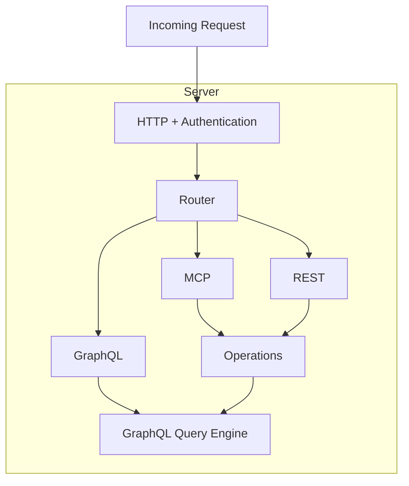

<!-- reference documentation -->

Based on the SQRL script, DataSQRL generates the interface for the compiled data pipeline. DataSQRL supports the following interfaces:

* Data Product (Data Lake Views and Database Views)
* GraphQL (Mutations, Queries, and Subscriptions)
* MCP (Tooling and Resources)
* REST (GET and POST)

For data products, DataSQRL generates view definitions as deployment assets in `build/deploy/plan` which can be queried directly.

The last three are APIs that can be invoked programmatically. The `protocols` compiler configuration controls which API protocols are exposed by the server.

## Data Products

For data products, each visible table defined in the SQRL script is exposed as a view or physical table depending on the pipeline optimization. The mapping between visible tables in the SQRL script and exposed tables in the interface is 1-to-1.

We recommend generating unique table names for the physical tables by configuring a table-name suffix in the connector configuration, e.g. by configuring the `table-name` for `postgres` or the `catalog-table` for `iceberg` to `${sqrl:table-name}_MY_SUFFIX` . This separates views from physical tables to provide modularity and support updates without impacting downstream consumers.

## APIs

When a server engine is configured, the tables, relationships, and functions defined in a SQRL script map to API endpoints exposed by the server.
DataSQRL builds an object-relationship model from the tables and relationships between them. Tables are mapped to objects with each scalar column as a field. Fields that are nested rows are mapped to child objects with field name as the parent-to-child relationship. Relationships defined between tables are mapped to relationships between the corresponding objects.

### GraphQL

DataSQRL uses the GraphQL data model as the base model for all API access to data because there is a natural 1-to-1 mapping between the object-relationship model of a SQRL project and GraphQL schema:
Each object maps to a type or input and each relationship maps to a relationship field on the respective types.

#### Model-to-Schema Mapping

Specifically, tables and functions are exposed as query endpoints of the same name and argument signature (i.e. the argument names and types match).
Tables/functions defined with the `SUBSCRIBE` keyword are exposed as subscriptions.
Internal table sources are exposed as mutations with the input type identical to the columns in the table excluding computed columns.

In addition, the result type of the endpoint matches the schema of the table or function. That means, each field of the result type matches a column of the table/function or a relationship by name (see [Schema Customization](#schema-customization) for how relationship fields resolve) and the field type is compatible.
The field type is compatible with the column/relationship type iff:
* For scalar or collection types there is a native mapping from one type system to the other
* For structured types (i.e. nested or relationship), the mapping applies recursively.

#### Base Tables

To avoid generating multiple redundant result types in the API interface, the compiler infers the base table for each defined table and function.

The base table for a defined table or function is the right-most table in the relational tree of the SELECT query from the definition body if and only if that table type is equal to the defined table type. If no such table exists, the base table is the table itself.

The result type for a table or function is the result type generated for that table's base table.
Hidden columns, i.e. columns where the name starts with an underscore `_`, are not included in the generated result type.

#### Schema Generation

If no GraphQL schema is configured, the compiler infers one from the SQRL script and writes it to `build/inferred_schema.graphqls`.

Configure the default `v1` schema with `script.graphql`. To serve multiple API versions, configure each version under `script.api`; each version must provide a GraphQL schema, GraphQL operations, or an OpenAPI compatibility specification. When a version does not provide a schema, the compiler infers one from the SQRL script.

A useful customization workflow is to compile without a configured schema, copy `build/inferred_schema.graphqls` into the project (for example, `api/schema.v1.graphqls`), then configure that file as the API schema.

#### Schema Customization

If a GraphQL schema is defined, the compiler maps the object-relationship model onto the provided schema. You can write your own GraphQL schema or modify the generated GraphQL schema to control the exposed interface. Any modifications must preserve the mapping to the object-relationship model described above.

You can customize the GraphQL schema by:
* Changing field cardinalities (e.g. `[Person]!` to `Person!`)
* Changing scalar types (e.g. `Long` to `Int`)
* Changing the argument name for mutations (e.g. `event` to `payload`)
* Changing the type of fields to compatible types (e.g. `Person` to `SpecificPerson`)
* Adding enums
* Adding interfaces and structuring types with interfaces

With a provided GraphQL schema, the compiler matches each GraphQL field to an item in the SQRL script:
* A field of `type Query` matches the queryable SQRL table or SQRL function with the same name, and a field of `type Subscription` matches the `SUBSCRIBE` table or function with the same name. The compiler does not check that a field is in the matching root type.
* A field of the type that a table, function, or relationship returns matches the first of:
  1. the SQRL relationship `<GraphQL type name>.<field name>`
  2. the column with the same name in the returned rows
  3. the SQRL relationship `<base table>.<field name>`, with the [base table](#base-tables) of the table, function, or relationship

  So the type can have any name, unless a relationship field must resolve by the type name.
* Only a base table can own a SQRL relationship, not a SQRL function or a table whose base table is another table. A function or table that returns only some columns of a table has no base table, so its type reaches that table's relationships only by the type name, for example `OrderById(id: Long!): OrderRecord` for `OrderRecord.items`. Its rows must include the parent columns that the relationship reads (`this.id`). Otherwise the relationship gets `null` and returns no rows, without a compile error.
* All tables, functions, and relationships that return the same type must resolve its relationship fields to the same relationships, so a field that resolves on the base table needs the same base table for all of them. Otherwise the compile fails with `Type [<type>] is returned by [...] with base table [...] and by [...] with base table [...], which resolve its relationship fields differently. Use a separate type for each base table.`
* A nested GraphQL type that the compiler reaches through a relationship can have its own relationship fields, by the same rules.
* A nested GraphQL type that the compiler reaches through a column with nested data (`ROW<...>` or `ARRAY<ROW<...>>`) can have only column fields. The compiler does not look for relationships inside a column.
* The compiler checks the column fields of each GraphQL type only once, against the rows of the first field that returns it. If several fields return the same type, the rows of each must contain all its column fields. A missing column compiles and returns `null`. Do not use one type both for a column with nested data and for a table or function result.

Mutation input fields must match the column types of the table. A `String` column also accepts enum, `ID`, and `JSON` inputs, where JSON objects and arrays are stored as JSON text. Nullable columns can be omitted from the mutation input. If the mutation result type still includes them, those fields must be nullable and return `null`. In a nested input type, an omitted nullable field must also be omitted from the nested result type.

A GraphQL field that matches no SQRL item stops the compile. The error depends on the type that holds the field:
* A field of `type Query` or `type Subscription` gives `Could not find table or function for field: <field>`. Compare the field name with the names of the SQRL tables and SQRL functions. A matching name also gives this error if the table or function is not queryable: hidden (`_` prefix), marked `/*+no_query*/`, or not defined in the main script or imported inline (`IMPORT otherscript.*`).
* A field of `type Mutation` gives `No mutation found for <field>`. Compare the field name with the names of the mutation tables.
* A field of the input type of a mutation gives `Field '<field>' is not present in the mutation table input`. Compare the field name with the columns of the mutation table.
* A field of the result type of a mutation without a field of the same name in the input type, and a non-null column of the mutation table that is missing from the input type, both give `Could not find field <field> in type <mutation>`. The result type is checked first. If `<field>` is a non-null column of the mutation table, add it to the input type or make the column nullable. Otherwise, remove it from the result type. Exceptions for the result type:
  * A metadata column (`event_time TIMESTAMP_LTZ(3) METADATA FROM 'timestamp'`, `'uuid'`, `'auth.<claim>'`) belongs only in the result type, and the server fills it.
  * A computed column (`total AS price * quantity`) can also stay in the result type, but the server does not compute it and returns `null`. Its result field must be nullable, or the mutation fails at runtime after the event was written.
  * A nullable top-level column left out of the input. Its result field must be nullable, or the compile fails with `Field '<field>' is omitted from the mutation input, so it must be nullable in the mutation result`.
* A field of the result type of a query or a subscription gives `Unknown field at location <type>.<field>. No relationship [<type>.<field>] or [<base table>.<field>] exists. Relationships named [<field>] exist on other tables: <Table>.<field>. Possible scalars are [...]`. The scalar list shows only the columns that the compiler searched. The other-tables part appears only if such relationships exist, and a nested type reached through a column has no relationship parts. For a relationship field, name the type after a listed table that has the relationship, or make that table the base table of the query.

:::warning
The compiler raises errors when the provided GraphQL schema is not compatible with the object-relationship model.
:::

#### Authoritative Model

DataSQRL uses the GraphQL schemas the authoritative model for all API protocols. It serves as the foundational model on which operations, endpoints, and access patterns are defined. This simplifies the conceptual model and server execution since any API operation maps to a GraphQL query which is executed by a centralized and optimized GraphQL engine.

The GraphQL query execution engine sits at the core of the DataSQRL server engine and executes all requests even if the GraphQL API is not exposed. This ensures uniform execution of all requests and a shared authentication and authorization mechanism for security.

`compiler.api.protocols` controls the public API surface. Include `GRAPHQL` to expose the versioned GraphQL HTTP, WebSocket, and (when enabled) GraphiQL routes; include `REST` and/or `MCP` to expose operations through those protocols. Omitting `GRAPHQL` leaves the GraphQL engine internal for REST/MCP requests but does not register GraphQL HTTP, WebSocket, or GraphiQL routes.

`compiler.api.endpoints` controls generated operations and GraphQL flexibility: `FULL` generates operations for every query and mutation (and is the default), `GRAPHQL` keeps public GraphQL flexible but exposes only explicit REST/MCP operations, and `OPS_ONLY` accepts only explicit named operations through a public GraphQL endpoint.



### MCP and REST

DataSQRL exposes an endpoint in MCP or REST for each GraphQL operation.
DataSQRL generates a list of operations from the GraphQL schema: one for each query and mutation endpoint.
* Queries are mapped to REST GET endpoints under `rest/queries`; mutations are mapped to REST POST endpoints under `rest/mutations`. For generated result sets, DataSQRL follows relationship fields up to a configured depth `max-result-depth` without loops.
* When `add-prefix` is enabled (the default), generated query and mutation operations are named with `Get` and `Add` prefixes. MCP exposes generated operations as tools, including those with nested input types, which are passed as nested JSON objects and arrays. Add `@api(mcp: NONE)` to a query or mutation field in the GraphQL schema to omit its generated operation from MCP.

For complete control over the exposed MCP tools and resources as well as REST endpoints, define named GraphQL operations in one or more `.graphql` files configured under `script.operations` (or `script.api.<version>.operations`).

The GraphQL file defining the operations contains named queries or mutations.
The name of the operation is the name of the MCP tool and REST endpoint and must be unique.

The `@api` directive is applied to the directive to control how the operation is exposed:
* `rest`: `NONE`, `GET`, or `POST` to configure the HTTP method or not expose as REST endpoint.
* `mcp`: `NONE`, `TOOL`, or `RESOURCE` to configure how the query is exposed in MCP.
* `uri`: AN RFC 6570 template to configure the REST path and MCP resource path. Any operation arguments that are not defined in the uri template are considered part of the payload for REST (and the method must be POST).

```graphql
""" Returns up to 10 people for a given age """
query GetPersonByAge($age: Int!) @api(rest: GET, mcp: TOOL, uri: "/queries/personByAge/{age}") {
    Person(age: $age, limit: 10, offset: 0) {
        name
        email
    }
}
```

This defines an operation `GetPersonByAge` which is the name of the MCP tool and REST endpoint with the path `/queries/personByAge/{age}` using GET method.

The doc strings for the operations are used in the API and tooling documentation.

By default, DataSQRL adds explicit operations to the generated ones. Set `compiler.api.endpoints` to `OPS_ONLY` to omit generated REST/MCP operations and restrict a public GraphQL endpoint to explicitly defined named operations. The server executes its stored operation definition, so clients cannot alter its selection set.

### OpenAPI and API Versioning

OpenAPI describes the REST API derived from GraphQL operations; it is not a second API definition. DataSQRL generates an OpenAPI 3 document for every compiled API version from REST-exposed operations at `deploy/plan/vertx-<version>-openapi.json` under the build directory: `build/` normally or `build/<sub-project>/` when compiling with `-b`.

Top-level `script.graphql` and `script.operations` configure one `v1` API. Use `script.api` for concurrent versions; version names start with `v` followed by a number. When `script.api` is present, it defines the API versions to compile and serve, and top-level API fields are not used. Configure `script.api.<version>.openapi` with a previous generated document only to have compilation fail on backwards-incompatible REST changes.

### Testing

DataSQRL's automated testing via the `test` command executes all GraphQL queries inside the configured `test-folder` and snapshots the returned results. Queries are executed in this order:

1. All subscription queries are registered. Note that subscriptions can only be tested if triggered by mutations.
2. Mutations are executed sequentially in alphabetical order of filename. The test runner waits the configured `mutation-delay-sec` between mutations. Results are written as snapshots to the snapshot folder.
3. The test runner waits for the pipeline to process the data (see `delay-sec` and `required-checkpoints` in the test-runner configuration).
4. Queries are executed and results written as snapshots.
5. All subscription results are sorted and written as snapshots.

If a snapshot already exists, results are compared and the test fails if they are unequal. If a snapshot does not exist yet, it is created and, provided no other test failed, verified by re-running the pipeline in the same test invocation.

The test runner uses the configured `headers` for accessing the API. To test authentication and authorization with different access tokens, create a properties file with the same name as the GraphQL file to configure header properties per query.

For example, if your test folder contains `myquery.graphql` you can configure custom headers for this query in `myquery.properties`:
```text
Authorization: Bearer XYZ
```

By default, tests use the inferred schema even when a custom schema is configured. Set `test-runner.use-inferred-schema` to `false` to test against the configured schema instead.
